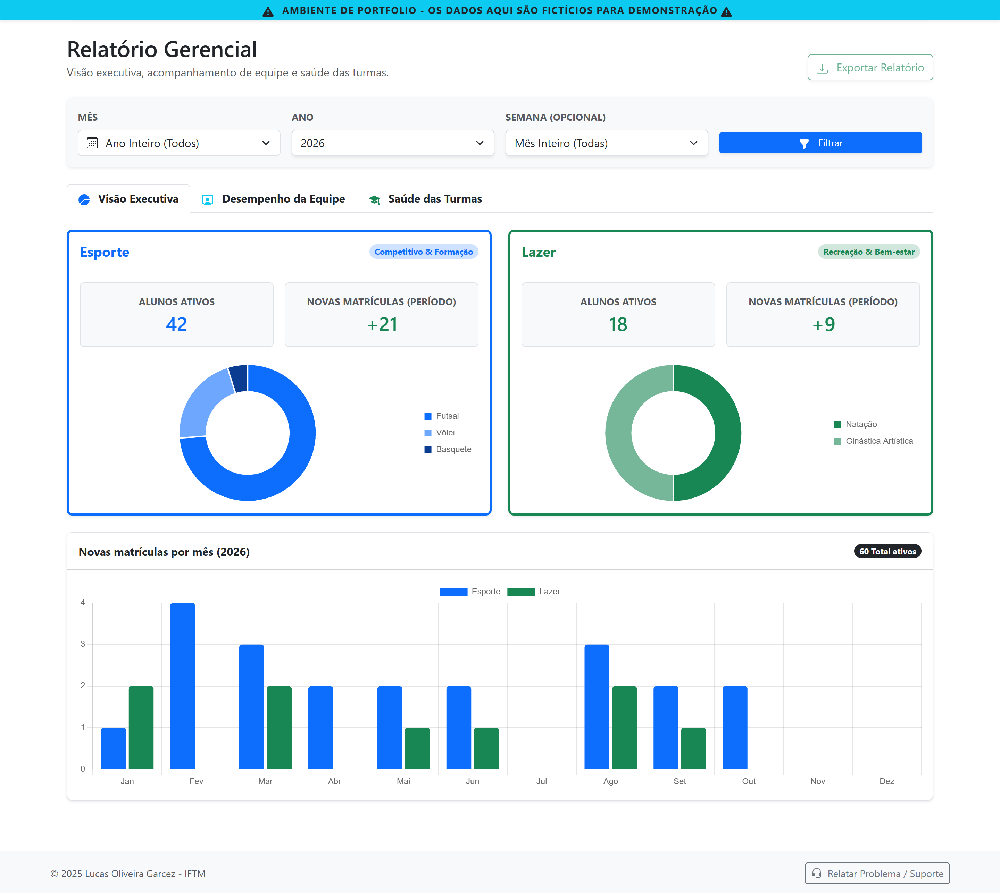
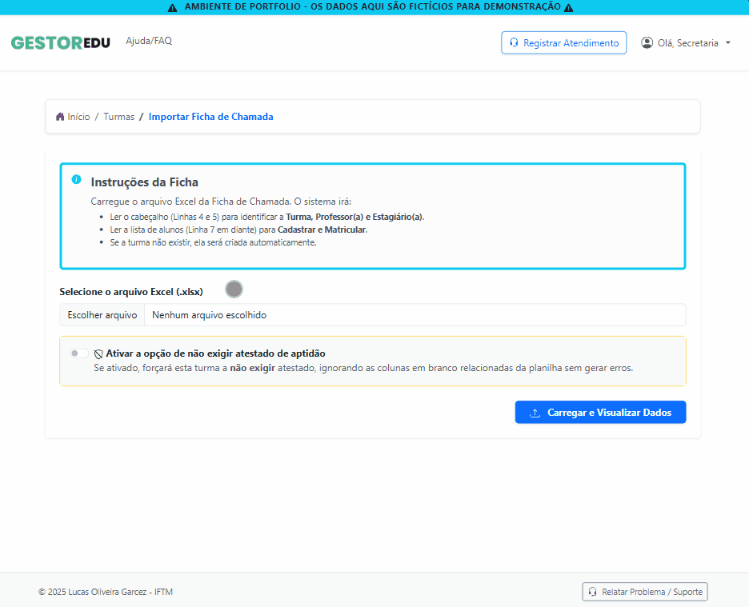
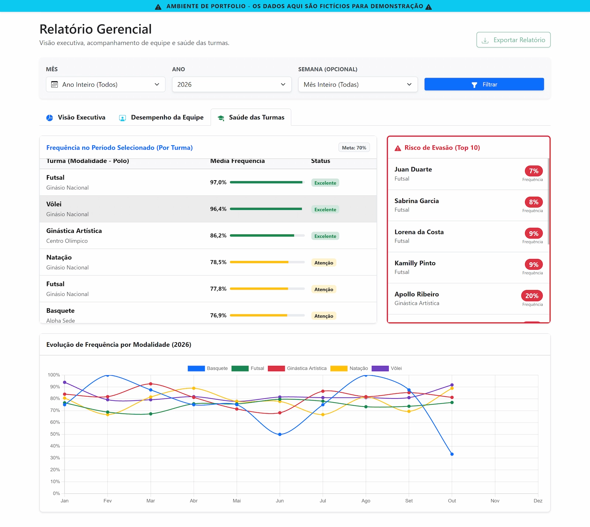
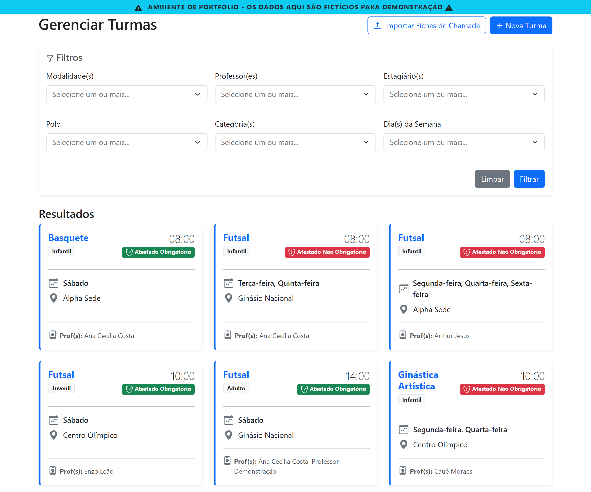
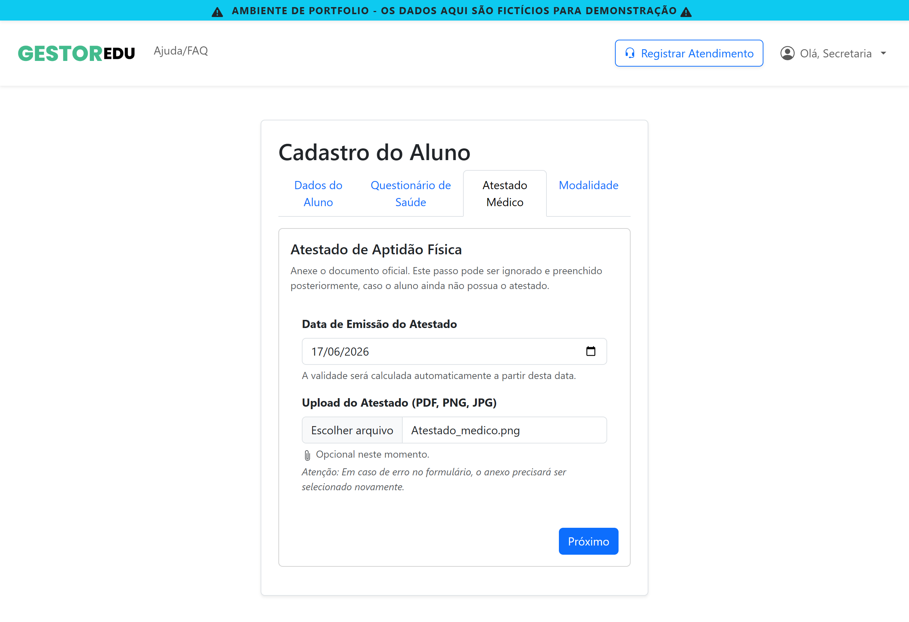
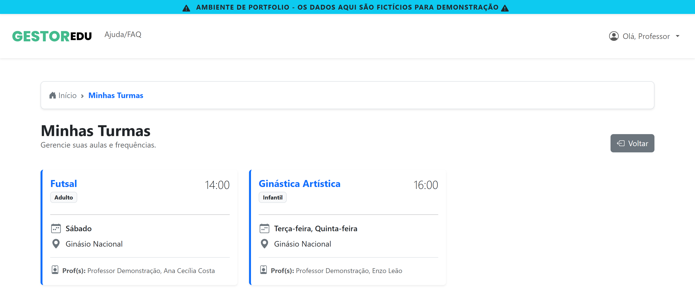
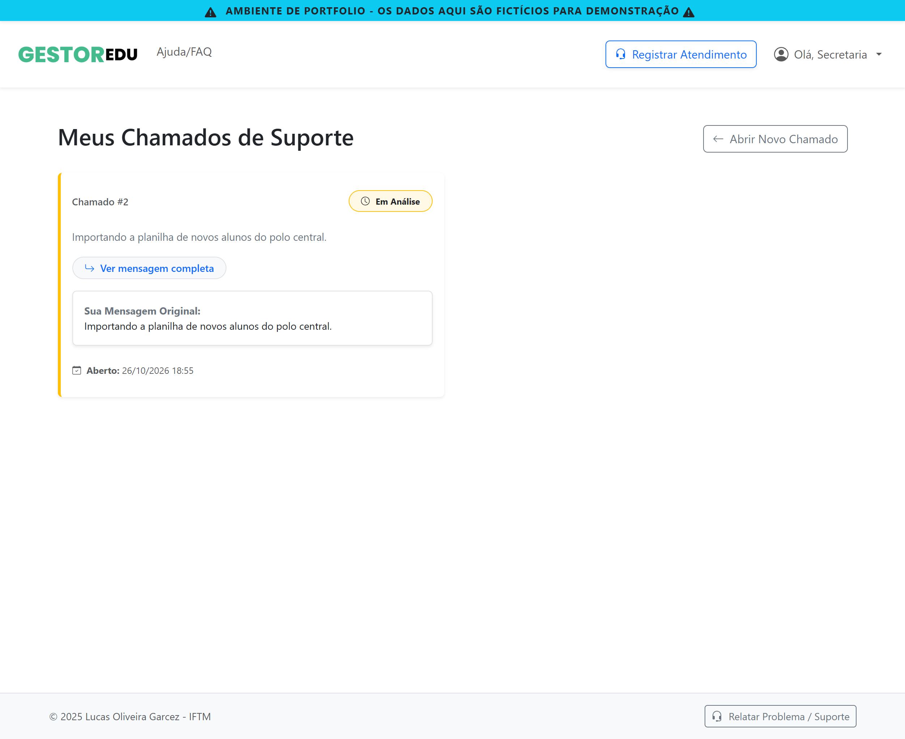
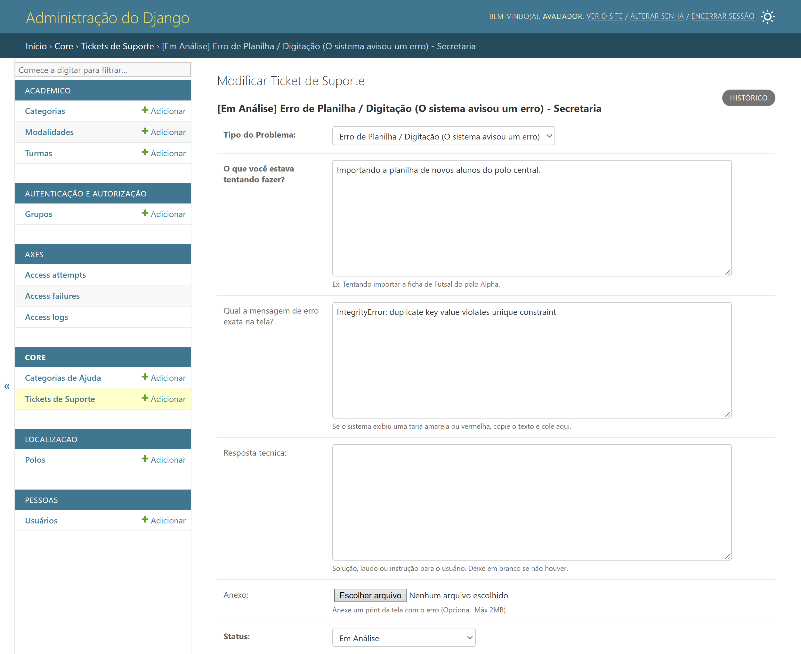
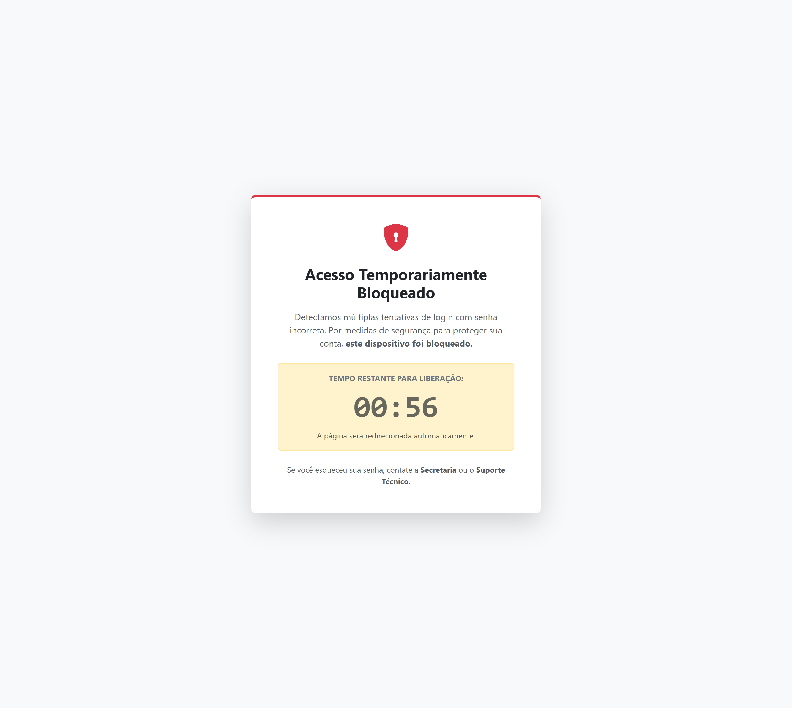

# 🏛️ Sistema de Gestão Acadêmica

> **Aviso:** esta é uma versão de portfólio (sanitizada e anonimizada) de um software real, **produto comercial de código fechado**, desenvolvido inicialmente como projeto de extensão universitária (IFTM) para otimizar processos em fundações públicas de esporte e lazer.

*Visão executiva: alunos ativos e novas matrículas por mês, divididos entre Esporte e Lazer.*

🔗 **[Acessar a demo online](https://django-edu-manager.onrender.com)** (contas de teste na seção *Live Demo*, mais abaixo)

---

## 📌 Visão Geral

Plataforma de gestão acadêmica para fundações públicas de esporte e lazer, usada por cerca de **65 funcionários** para gerir mais de **5.500 alunos**. Cobre cadastro de alunos, matrículas, alocação de turmas, lançamento de frequência, controle de atestados de saúde e relatórios gerenciais.

Desenvolvida em Django e PostgreSQL, une eficiência operacional (alocação de turmas e modalidades) com engenharia sólida: importação robusta de planilhas, formulários de saúde dinâmicos, controle de acesso por perfil e testes automatizados.

---

## ✨ Destaques de Engenharia

* 📥 **Parser de Excel resiliente:** algoritmo próprio (`import_utils.py`) que lê planilhas desestruturadas, contornando células mescladas, dados ausentes e colisões de chave composta.
* 📋 **Formulários de saúde dinâmicos:** módulo de atestados com travamento condicional de campos e regras de preenchimento, com exceções de validação para a diretoria e a secretaria.
* 🛡️ **Segurança no login:** proteção contra força bruta com `django-axes`, incluindo tela de bloqueio com contagem regressiva.
* 🧪 **Testes automatizados:** lógica de modelos com `pytest` e testes de ponta a ponta (E2E) do upload de arquivos em formulários de várias etapas com `Playwright`.
* 📈 **Dashboard gerencial e risco de evasão:** agregações em SQL via ORM do Django (`Annotate`, `ExpressionWrapper`, `TruncMonth`) para relatórios em tempo real, incluindo o cálculo de risco de evasão (frequência abaixo de 70%).
* 🔐 **Permissões por perfil:** cinco perfis de acesso, com o professor restrito às turmas em que está alocado (relação N:N).

---

## 🖼️ Telas do Sistema

### Importação de planilhas Excel

*Planilha com células vazias e documento duplicado: o parser importa o que é válido e informa o que foi ignorado.*

### Relatório gerencial: saúde das turmas e risco de evasão

*Frequência de cada turma, os alunos em risco de evasão (abaixo de 70%) e a evolução mensal por modalidade. A visão executiva aparece no topo desta página.*

### Gestão de turmas

*Filtros combinados e cards com horário, dias, polo e professores. A tag indica se a turma exige atestado.*

### Cadastro do aluno em etapas

*O cadastro é dividido em quatro etapas: Dados do Aluno, Questionário de Saúde, Atestado Médico e Modalidade. A imagem mostra a etapa do atestado, que é **opcional**: pode ser preenchida depois, caso o aluno ainda não tenha o documento.*

### Controle de acesso por perfil

*O professor vê somente as turmas em que está alocado.*

| Secretaria | Admin |
| :---: | :---: |
|  |  |
| *Acompanha o chamado, mas não responde.* | *Único perfil que responde e fecha chamados.* |

### Proteção contra força bruta

*Após tentativas inválidas seguidas, o login é bloqueado e exibe o tempo restante.*

---

## 🚀 Live Demo (Acesso Rápido)

O sistema está hospedado na nuvem, com um banco populado com dados fictícios. A primeira carga pode levar cerca de um minuto.

🔗 **Acesse a plataforma:** [https://django-edu-manager.onrender.com](https://django-edu-manager.onrender.com)

Para testar as permissões de cada perfil, use as contas abaixo.

🔑 **Senha de todas as contas:** `senha123`

| Perfil | E-mail de login | O que pode fazer |
| :--- | :--- | :--- |
| **⚙️ Admin** | `admin@portfolio.com` | **Acesso total.** Vê todas as tabelas e é o único que **responde e fecha** chamados de suporte. |
| **🛡️ Diretoria** | `diretor@portfolio.com` | **Acesso global:** gestão de polos, matrizes curriculares, usuários e auditoria do sistema. |
| **📂 Secretaria** | `secretaria@portfolio.com` | **Operacional:** alunos, matrículas, alocação de turmas e abertura de chamados. |
| **👨‍🏫 Professor** | `professor@portfolio.com` | **Restrito:** acessa apenas as turmas em que está alocado (relação N:N). |
| **🧑‍💻 Estagiário** | `estagiario@portfolio.com` | **Somente apoio:** perfil de leitura com endpoints bloqueados, para demonstrar a validação no backend. |

> **💡 Dica de teste (privilégios):** entre como **Professor** ou **Secretaria** e abra um chamado de suporte. Note que a interface não permite responder a ele. Depois entre como **Admin**, veja todos os chamados e envie a resposta, comprovando a proteção contra escalonamento de privilégios.

---

## 🛠️ Tecnologias Utilizadas

* **Backend:** Python 3, Django, Django REST Framework
* **Banco de dados:** PostgreSQL
* **Frontend:** HTML5, CSS3, JavaScript (Vanilla), Bootstrap
* **Testes:** Pytest, Playwright (E2E)
* **Infraestrutura:** Docker, Docker Compose
* **Segurança:** Django Axes (limite de tentativas de login)

---

## 🗂️ Sobre este Repositório (Showcase)

Este é um produto B2B/B2G de código fechado, comercializado como SaaS para o setor público. O repositório principal, com o código completo, é mantido **privado** para proteger a propriedade intelectual.

Este repositório público é uma **vitrine**: reúne trechos reais de código, anonimizados, que mostram as práticas de engenharia do projeto.

* 📂 `seed_portfolio.py`: script de carga de dados de demonstração, idempotente (`get_or_create`), que cria polos, turmas, usuários e um histórico de chamadas simulado para alimentar o cálculo de evasão.
* 📂 `utils.py`: algoritmos de limpeza e transformação de dados (*data cleansing*).
* 📂 `relatorios_gerenciais.py`: views com a lógica de agregação SQL do painel gerencial.
* 📂 `docker-compose.yml`: ambiente de desenvolvimento com contêineres.

Para ver o sistema funcionando, com suas validações, segurança e interface, use a **Live Demo** acima.

---

## 📄 Licença

Este projeto está sob a licença Apache 2.0. Consulte o arquivo [LICENSE](LICENSE) para mais detalhes.
